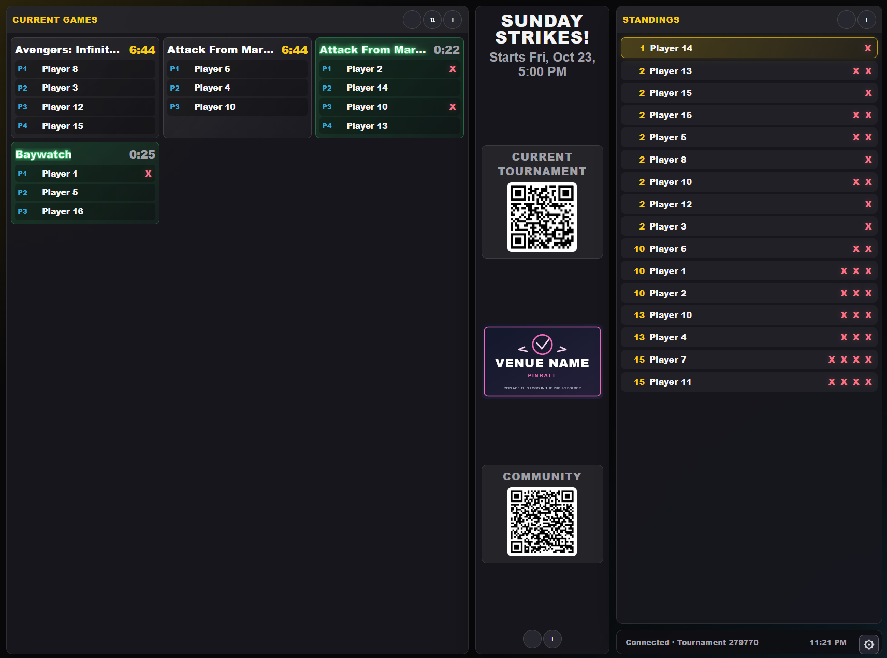
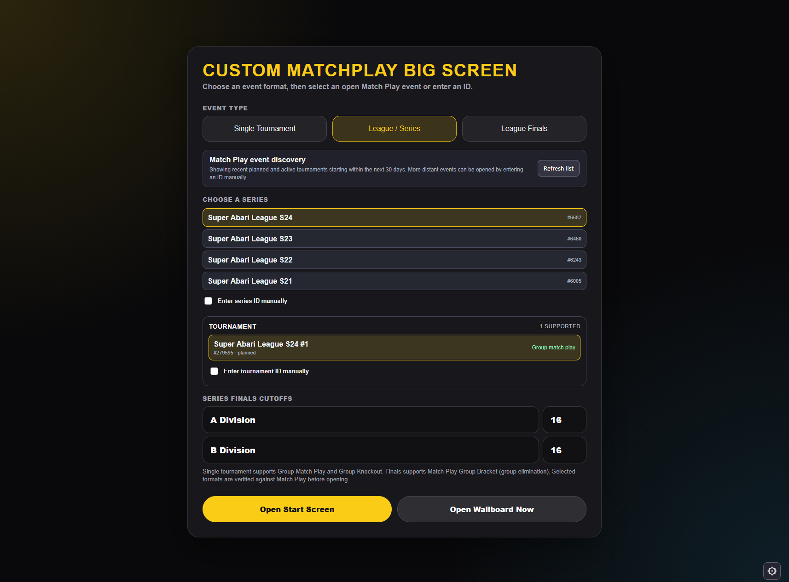
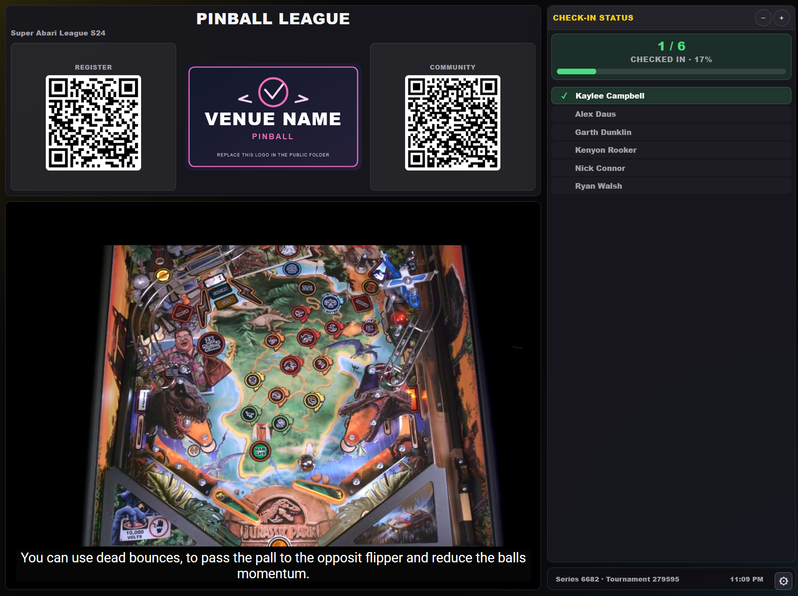
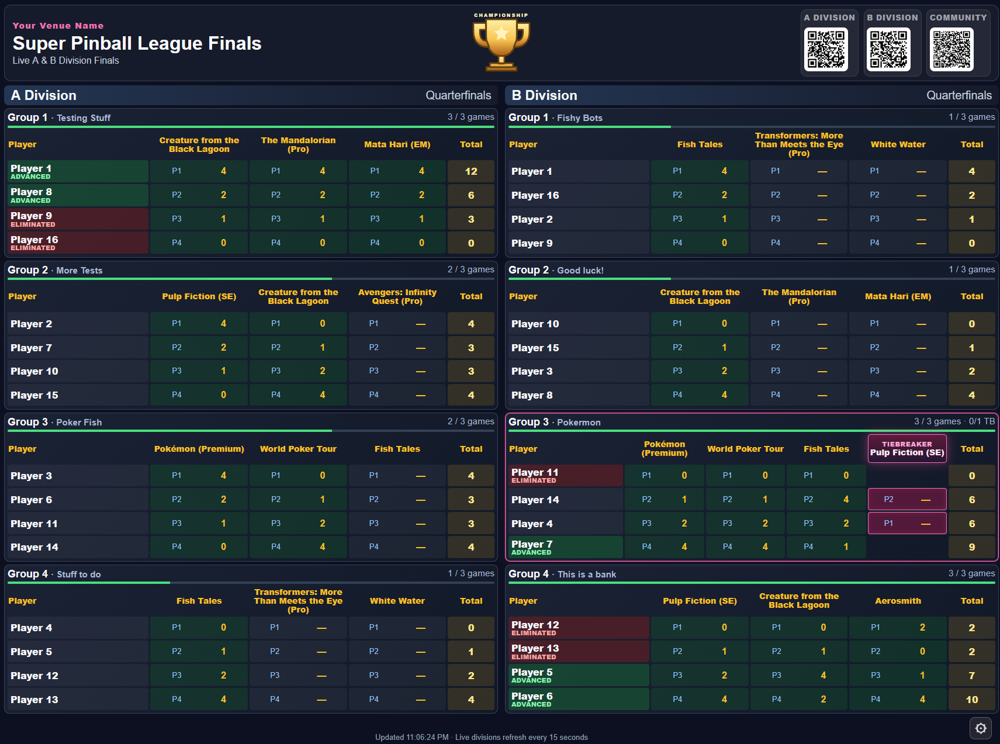

# Custom Matchplay Big Screen

**Public beta · Community project · Contributions welcome**

Custom Matchplay Big Screen is a browser-based display for competitive pinball tournaments and leagues using the [Match Play Events](https://matchplay.events/) API. Run it on the computer connected to your projector or TV to show live games, standings, check-in, or league finals.

This is an independent community project, **not an official Match Play application**. Match Play remains the authoritative source for tournament results.

### Live tournament display

[](screenshots/tournament-wallboard.png)


> **Maintenance:** This project began as a display for my own events. I'm sharing it for other tournament directors to use, adapt, and improve. I expect to review significant bug reports during the initial public beta (roughly the first one to two months, through December 2026), as time permits. I can't promise ongoing maintenance, individual setup support, new formats, or long-term compatibility. Well-scoped bug reports and community pull requests are welcome. Please test with your own events before relying on it at a tournament.

## Supported tournament formats

**Please check your tournament format before installing.**

| Display mode | Supported Match Play format | What it shows |
| --- | --- | --- |
| **Single Tournament** | **Group Match Play** or **Group Knockout** | Current games, standings, and tournament information |
| **League / Series** | Match Play **series**, with a selected **Group Match Play** or **Group Knockout** tournament | Check-in, registrations, series standings, and tournament display |
| **League Finals** | **Group Bracket** (group-elimination finals) | One or two divisions, advancement, tiebreakers, championship placements, and final standings |

Other Match Play formats, including Best Game, Pingolf, and formats other than those listed above, are **not currently supported**. The launcher identifies incompatible events and explains why they cannot be selected. Manual ID entry is available, but does not remove format restrictions.

## Screenshots

A look at the different screens included in the beta. Select any image to view it full size.

| Event launcher | League / Series check-in | League Finals |
| :---: | :---: | :---: |
| [](screenshots/launcher.png) | [](screenshots/league-checkin.png) | [](screenshots/league-finals.png) |

## Before you begin: what you need

You **do not need programming experience** to try the beta. Setup is easiest on a Windows laptop with a browser and an internet connection. The application runs locally on the computer connected to your projector or TV.

| Prerequisite | Required? | What it does |
| --- | --- | --- |
| **Node.js (22.12 or newer)** | Yes | Runs the application. Installing Node.js also installs **npm**, the tool that downloads project dependencies. Choose a currently supported **LTS** version. |
| **Match Play API token** | Yes | Lets the app fetch your authorized tournament and series data. Keep the token private. |
| **Chrome, Firefox, or Edge** | Yes | Opens the display in a browser. |
| **Internet connection** | Yes, for live use | Loads Match Play data, plus externally hosted QR images and optional YouTube content. |
| **Git** | No | Makes downloading and updating the project easier. You can use a GitHub ZIP download instead. |
| **Visual Studio Code** | No | Optional text editor for adjusting venue settings; Notepad works for basic setup. |

### Step-by-step setup for Windows (first-time users)

**1. Install Node.js and npm**

1. Go to **[nodejs.org](https://nodejs.org/)** and download the **LTS** installer for Windows. Use the official Node.js website rather than a third-party download site.
2. Run the installer. You can accept the normal installation defaults; ensure npm is included (it normally is).
3. Close any PowerShell windows that were already open, then open a **new PowerShell** window (Start menu → type **PowerShell** → Open).
4. Verify both commands work:

   ```powershell
   node --version
   npm --version
   ```

   Both should print version numbers. Node must be **22.12 or newer**. If either command is not recognized, reopen PowerShell; if that doesn't help, reinstall Node.js and confirm it was added to your PATH.

**2. Download Custom Matchplay Big Screen**

**Option A — No Git required (simplest for testers):**

1. Open the [Custom Matchplay Big Screen GitHub repository](https://github.com/kayleecamp42/custom-matchplay-big-screen).
2. Select **Code → Download ZIP**.
3. In File Explorer, right-click the downloaded ZIP and choose **Extract All**. Choose an easy-to-find destination such as your **Documents** folder.
4. Open the extracted folder that contains `package.json`, `server.js`, and `.env.example`. This is the **project folder**. Depending on the downloaded archive name, it may have a suffix such as `-main`.

**Option B — Git (easier to update later):**

1. Install Git for Windows from **[git-scm.com](https://git-scm.com/downloads/win)**. Reopen PowerShell after installing it.
2. In PowerShell, choose a location for the project (for example, your Documents folder) and clone it:

   ```powershell
   cd "$HOME\Documents"
   git clone https://github.com/kayleecamp42/custom-matchplay-big-screen.git
   cd custom-matchplay-big-screen
   ```

   If your Documents folder is redirected to OneDrive or another location, adjust the `cd` command or use the File Explorer method below.

**3. Open PowerShell inside the project folder**

For either download method, the easiest option is to open the project folder in **File Explorer**, click the address bar, type `powershell`, and press **Enter**. A PowerShell window opens in that folder.

Confirm you are in the correct folder:

```powershell
Get-ChildItem package.json, server.js, .env.example
```

You should see all three filenames. If PowerShell reports that they do not exist, you're in the wrong folder; navigate to the directory containing them.

**4. Install the application dependencies**

Run this **once for each new download or clone**, and again when a later update changes dependencies:

```powershell
npm install
```

This downloads packages into `node_modules/`. It can take a little while and requires internet access. **Do not skip this step**: otherwise the app may fail with a missing `vite` module error. `node_modules/` is intentionally not included in GitHub source downloads.

**5. Create your private `.env` file and add your Match Play token**

Run:

```powershell
Copy-Item .env.example .env
notepad .env
```

In the file that opens, locate the `MATCHPLAY_TOKEN` setting and replace its placeholder with your **own Match Play API token**. Keep other settings from the example unless you have a reason to change them. The essential values look like:

```dotenv
MATCHPLAY_TOKEN=your_actual_token_goes_here
PORT=8787
```

Get your API token through Match Play's account/API settings or its official developer documentation. The exact website menus may change; **do not enter your Match Play account password instead of a token**. If you cannot locate a token, consult Match Play's current instructions. Save the file and close Notepad.

**Security:** Never share `.env`, paste its contents into a public GitHub issue, or include it in a ZIP you distribute. `.env.example` is only a template and should not contain your real token.

**6. Start both parts of the app with one command**

From the same project folder, run:

```powershell
npm start
```

Keep the PowerShell window open. The terminal should print the local display URL, typically **http://localhost:5173/**. Open that address in Chrome, Firefox, or Edge. If it prints a different port, use the exact address shown.

You should now see the launcher. Choose a supported tournament or series from automatic discovery, or enter an event ID manually. See [Select an event](#select-an-event).

**7. Use the display and shut it down**

Connect your laptop to your TV/projector, then press **F11** in the browser if you'd like full-screen mode. To stop the application, return to PowerShell and press **Ctrl+C**. The next time you use it, open PowerShell in the project folder and run **`npm start`**; you do **not** need to rerun `npm install` every time.

### macOS and Linux (short setup)

Install a currently supported Node.js LTS version (**22.12+**, including npm), then download or clone the repository. Open Terminal in the project folder and run:

```bash
npm install
cp .env.example .env
```

Edit `.env` with your Match Play API token using your preferred editor, then launch with `npm start`. Open the local URL printed in Terminal. Use **Ctrl+C** to stop. Git is optional if you download and extract the GitHub source ZIP.

### Optional HTML shortcut

`open-display.html` in the project root can be opened from a desktop shortcut. If the display is running on the default `localhost:5173` address, the file opens it in your browser. Otherwise it shows instructions to start the app. **The shortcut does not start Node.js or run `npm start` for you.** If Vite chooses another port, use the URL shown in the terminal.

## Select an event

The launcher offers three modes: **Single Tournament**, **League / Series**, and **League Finals**. It attempts to discover events owned by the configured Match Play organizer, and it also supports entering tournament or series IDs manually.

- **Automatic discovery** includes planned and active events with known start times within the next **30 days**. It searches a limited recent history, so older or unlinked series may not appear. Events with unknown start dates may still appear.
- Unsupported events are shown with a short reason; supported events identify their format.
- **Manual IDs** can access events outside the discovery date window, subject to supported format checks.
- **League Finals** supports one Group Bracket tournament in **Single Division** mode, or separate A/B tournament IDs in **Two Divisions** mode. Only the current round is shown. Finals stop refreshing after final results are confirmed.

### If automatic discovery cannot identify your organizer

Your normal `MATCHPLAY_TOKEN` is still required. You do **not** need a Match Play password or a second token. If the authenticated profile lookup is restricted, add **one** of the following optional values to `.env`:

```dotenv
# Your numeric Match Play organizer/user ID:
MATCHPLAY_USER_ID=12345

# Alternatively, use the ID of a tournament you organized:
# MATCHPLAY_DISCOVERY_TOURNAMENT_ID=123456
```

These are examples, not usable IDs. Remove the `#` on a line to enable it. Stop and restart `npm start` after editing `.env`. If discovery still fails, use manual IDs and see Troubleshooting below.

## Customize your display

Change venue-specific defaults in **`src/config.js`**, then restart `npm start` and refresh the browser. **Do not put your API token here**: frontend source is visible to browser users.

| Setting | Purpose |
| --- | --- |
| `venueName` | Venue name in Finals |
| `appTitle`, `leagueTitle`, `finalsTitle` | Headings across the screens |
| `logoUrl` | Venue logo for wallboard and check-in |
| `communityUrl`, `communityLabel` | Community QR destination and label |
| `playlistId` | Check-in YouTube playlist; set to `""` to hide it |
| `directors` | Default names for tournament-director badges |
| `finals.headerImageUrl`, `finals.championImageUrl` | Finals artwork |
| `finals.winnerAText`, `finals.winnerBText`, `finals.winnerBIcon` | Winner labels and icon |

**Static assets belong in `public/`.** The default examples are `public/venue-logo.svg` and `public/championship-trophy.svg`. For a new image placed at `public/my-logo.png`, configure `logoUrl: "/my-logo.png"` (start with `/`, but don't include `public` in the URL). Replace the generic examples or supply your own. The included YouTube playlist is a sample default and can be changed.

The visible **gear icon** opens display settings; **Ctrl+K** remains available. Browser-saved TD names override the initial `directors` list in `src/config.js` for that browser. Other display preferences are also browser-local.

### Configure your community QR code

When `communityUrl` is blank, the QR card remains visible and points to **this section of the public GitHub README**. It is a placeholder—not a link to a local club or server. For your event, edit `src/config.js`:

```js
communityUrl: "https://discord.gg/your-invite",
communityLabel: "Join Our Community",
```

A public Facebook group, club website, or event page works too. **Scan the code with a phone before using it at a tournament**. The default GitHub destination requires the repository to be public and accessible to visitors. QR images are generated using an external service, so the display requires an internet connection for them.

## Displaying on a TV or projector

The supported setup is **a laptop or other computer connected directly to the display** (for example, over HDMI), with the application and browser running on that computer. Press **F11** on Windows for browser full-screen mode.

Currently the server is intended for **localhost-only access**. Connecting a smart TV or second computer directly to the laptop's LAN IP address is **not yet supported**; do not expose the token-backed API proxy or development server to an untrusted network.

## Updates and troubleshooting

To update a cloned installation, save or back up changes to tracked files such as `src/config.js` before running `git pull`. Then run `npm install` if dependencies have changed, and restart `npm start`. `.env` is local and ignored by Git.

| Problem | What to try |
| --- | --- |
| `node` or `npm` is not recognized | Follow **Step 1** above; install Node.js LTS and open a new terminal. |
| Missing Vite or `Cannot find module` | Run `npm install` in the project folder (Step 4); new downloads do not include `node_modules`. |
| Browser cannot open the display | Confirm `npm start` is still running; use the exact URL shown by Vite. |
| Port 5173 or 8787 is occupied | Close the earlier running app; Vite may choose a different frontend port. |
| Missing API token | Check that `.env` is next to `server.js`, has a real `MATCHPLAY_TOKEN`, and is not commented out. |
| Discovery fails, but manual IDs work | Check the token and optional organizer ID settings; restart both processes. The backend can report a more specific upstream error at `http://localhost:8787/api/launcher/discovery`. |
| Community QR is blank | Check connectivity and content blockers; QR images require an external image service. |
| Event is missing from discovery | It may be outside the 30-day future window, outside the limited history search, or an unlinked series. Use manual ID entry. |

**API routing for contributors:** Requests from the browser to `http://localhost:8787/api/...` are forwarded to `https://api.matchplay.events/api/...`. Both the `api.matchplay.events` host **and** the `/api` path prefix are required. Do not change this to `app.matchplay.events` or remove the `/api` prefix.

## For testers and contributors

Feedback is most useful when it includes the display mode and tournament format, what you expected, what happened, the approximate round/state, browser and OS, and a screenshot or safe reproduction steps. **Never post API tokens, `.env` files, or private participant information in a public issue.** Please search existing issues before filing a new one.

Pull requests are welcome for bug fixes, documentation, compatibility, and additional format support. Prefer focused changes with clear test steps. The current implementation uses React/Vite for the browser display and an Express proxy for Match Play API requests.

Contributor commands:

```bash
npm start       # Start frontend and backend together
npm run dev     # Frontend only (requires the backend to be running separately)
npm run server  # Backend only
npm run build   # Build frontend assets to dist/ (not served by npm start)
```

Live screens refresh while events are active, and some stop polling after completion is confirmed to reduce Match Play API traffic. More than one open browser tab increases API usage. Avoid unnecessary refreshes and respect Match Play availability.

### Feedback and Bug Reports

**Trying Custom Matchplay Big Screen? I'd love to hear how it works for you!**

Please use [GitHub Issues](https://github.com/kayleecamp42/Custom-Matchplay-Big-Screen/issues) to report bugs, suggest improvements, or share the results of your testing.

When reporting a bug, please include your tournament format, Match Play tournament ID (if shareable), a description of the problem, and screenshots when possible. Never share your API token.

I'm especially interested in significant issues affecting tournament displays during this initial beta period. Fixes will be considered as time permits, and community contributions are always welcome.

This is a volunteer open-source project, so individual technical support and ongoing maintenance aren't guaranteed.

### Support the Project

Custom Matchplay Big Screen is a free, open-source project developed and shared with the competitive pinball community.

If you find it useful and would like to buy me a coffee, beer, or a few extra pinball credits, optional donations are always appreciated!

**[Support the project via PayPal](https://paypal.me/kayleecamp42)**

Donations are completely optional and do not come with any expectation of additional features, technical support, or ongoing maintenance.

Thanks for helping make competitive pinball a little more fun!

— Kaylee Campbell


## Potential future enhancements

**Optional LAN / smart-TV display access** — Allow a tournament director to run the application on a laptop while a smart TV or another computer opens a **read-only display** using a local-network IP address. This would require an opt-in network mode, safe display-data endpoints, separation of admin/configuration controls from viewer access, and clear firewall instructions. **This is an idea for community contribution, not an implemented or promised feature.** The current default remains localhost-only for security.

Other enhancements may be proposed through GitHub Issues or pull requests. Suggestions do not imply a commitment to implement or maintain them.

## Security and licensing

Keep `.env` and API tokens private. Do not share the entire working directory as a ZIP: it may contain `.env`, `node_modules`, and Git metadata. If distributing source, use a clean GitHub checkout or GitHub's source archive. This project is provided **as-is**, without a support or uptime guarantee.

The project is distributed under the [MIT License](LICENSE).

## Acknowledgments

Thanks to [Match Play Events](https://matchplay.events/) for the tournament platform and API. **Custom Matchplay Big Screen is independent and is not affiliated with or endorsed by Match Play.**
